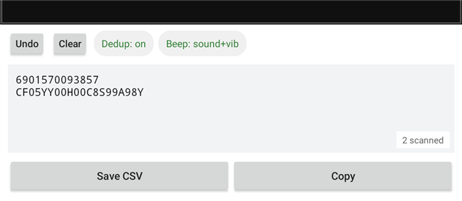

# Barcode Scanner (Saoma)

[中文说明](README.md) | **English**

A tiny Android barcode scanner built for warehouse use: **offline, one-tap fast, and free**.
Born out of a real annoyance — a warehouse with hundreds of cartons to check in, and every
scanner app that wanted a paid subscription just to *export the results*.



*Controls of the English build (the camera preview area is left out of this shot).*

## Download

Grab `barcode-scanner-v2.1-en.apk` from [Releases](../../releases), copy it to your phone and
tap to install (allow "unknown sources" if asked). Grant the camera permission on first launch.

- Android 5.0 (API 21)+, rear camera required
- Fully **offline** — the recognition model is bundled (no network calls; the INTERNET permission
  in the manifest comes with the ML Kit library, the app itself never uses it)
- ~5.9 MB, arm64-v8a / armeabi-v7a only
- Separate package (`com.saoma.scanner.en`) from the Chinese build — both can be installed side by side

## What it does

**One barcode in view** → green box, saved automatically after ~0.3 s of stable detection.
**Several barcodes** → red boxes, tap the one you want (or let "Pick" choose for you).

| Feature | Description |
|---|---|
| **1D only** | Code128 / Code39 / Code93 / Codabar / EAN-13 / EAN-8 / ITF / UPC-A / UPC-E. QR codes are ignored |
| **Light** | Torch toggle in the corner |
| **Dedup** | On by default: a barcode is only saved once (leading zeros normalised, so a UPC-A reported as 12 or 13 digits does not duplicate). Turn it off when counting many identical cartons |
| **Pick** | When several barcodes are in view: `smart` (remembers the kind of code you tapped last — format + length), `EAN/UPC`, `Code128`, or `manual`. In smart mode the chosen one gets a green “auto” box and a ~0.5 s confirmation window |
| **Scope** | Limit what is detected: `all`, `frame` (only barcodes inside a draggable/resizable box) or `line` (only barcodes crossing a red scan line). Anything outside the scope is **completely ignored** — not drawn, not saved, no sound |
| **Beep** | `none` / `sound` / `sound+vibration` / `vibration`. Saving is a crisp “beep”; a duplicate is a distinct “boop-boop” + double buzz + red hint bar |
| **Beat** | After saving one barcode, ignore further scans for N ms (off / 0.5 / 0.8 / 1.0 / 1.5 / 2 / 3 s). Keeps a steady rhythm when cartons are close together |
| **Undo / Clear** | Undo removes the last line; Clear wipes everything (with confirmation) |
| **CSV / Copy** | Export as CSV (UTF-8 with BOM, one barcode per line, opens cleanly in Excel) or copy to clipboard |
| **Never lose data** | Results are persisted as you type — switching apps, a phone call, or the app being killed by the system will not lose anything |

## Warehouse tips

- **Counting identical cartons** → turn **Dedup off**, otherwise only the first carton is saved.
  After a save, move the phone off the barcode for ~1 s to re-arm.
- **Fixed rhythm** → set **Beat** to 0.8–1.0 s so two nearby cartons don't double-beep.
- **Shaky hands** → turn the **light on** (short exposure = much less motion blur) and use
  **Scope: line** — putting a red line on the barcode is easier than fitting it inside a box.
- **Labels with 3–4 barcodes** → use `Scope: line` (fastest) or `Scope: frame`, then let
  **Pick: smart** resolve the rest.

## Test barcodes

`test/` contains printable 1D barcodes for trying the app out:

- `test/single.png` — a single EAN-13
- `test/multi.png` — two barcodes side by side (try “multiple barcodes” + tap-to-pick)

## Build it yourself

You need **JDK 17 + Android SDK 34 (build-tools 34.0.0) + Gradle 8.7**.

```
gradle assembleRelease
```

That produces both builds:

- `app/build/outputs/apk/zh/release/app-zh-release.apk` — Chinese (`com.saoma.scanner`)
- `app/build/outputs/apk/en/release/app-en-release.apk` — English (`com.saoma.scanner.en`)

- **No signing key or password is committed**: put your signing info in `keystore.properties`
  at the repo root (copy `keystore.properties.example`; the file is git-ignored).
  Without it the build still succeeds, just unsigned.
- `local.properties` needs your SDK path, e.g. `sdk.dir=C\:\\Android\\Sdk`
- Icons and sounds are committed; regenerate with `scripts/make-icons.ps1` / `scripts/make-beeps.ps1` if needed (PowerShell)

## Layout

```
app/src/main/java/com/saoma/scanner/MainActivity.java   UI, camera, detection, dedup/pick/scope/beat, export
app/src/main/java/com/saoma/scanner/OverlayView.java    boxes, scan frame and scan line (draw + drag)
app/src/main/res/layout/activity_main.xml               screen layout
app/src/main/res/values/strings.xml                     Chinese strings
app/src/en/res/values/strings.xml                       English strings (en flavour)
```

## Tech

CameraX 1.3.4 + ML Kit barcode-scanning 17.3.0 (bundled, offline), plain Java, no AppCompat,
~5.9 MB after R8.
