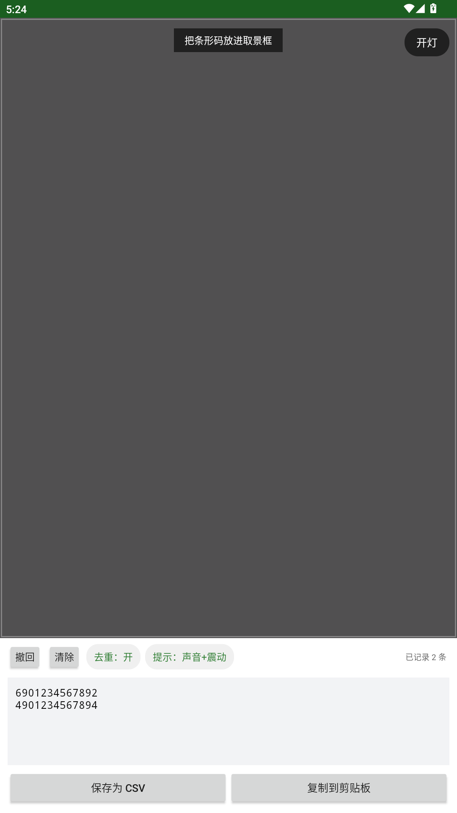

# 扫码器（Saoma Scanner）

一个极简的安卓条形码扫描工具。**只扫一维条码**，多码时红框点选，离线识别，结果可导出 CSV。
为仓库盘点、快递录入这类"要连着扫很多个"的场景做的。



## 下载安装

到 [Releases](../../releases) 下载 `saoma-scanner-v1.5.apk`，传到手机点击安装（提示"未知来源"允许即可）。
首次打开同意相机权限就能用。

- 系统要求：Android 5.0（API 21）及以上，需要后置摄像头
- 识别模型已内置，**完全离线，不联网**
- 安装包约 5.8 MB，只包含 arm64-v8a / armeabi-v7a

## 功能

- 上半部分是摄像头取景框，右上角有 **开灯/关灯** 按钮（手机闪光灯补光）。只识别一维条形码
  （Code128 / Code39 / Code93 / Codabar / EAN-13 / EAN-8 / ITF / UPC-A / UPC-E），**不认二维码**。
- 取景框里只有 1 个条码：绿色框，识别稳定约 0.5 秒后**自动记录**。
- 取景框里同时有多个条码：每个条码显示**红框**，需要**手动点击**要保存的那个。
- 「去重」开关（默认开）：同一个条码只记录一次。按「去掉前导 0」归一化，所以同一个 UPC-A
  被识别成 12 位或带 0 的 13 位也不会重复。要扫同一款商品的多个条码时，把它关掉。
- 「提示」按钮循环切换记录成功时的反馈：**无 / 声音 / 声音+震动 / 震动**（默认声音+震动，会记住选择）。
- **重复的条码**：不会重复记录，并且给一个**和"记录成功"不同的提示**（不同的"嘀"声 + 两声短震），
  顶部提示条同时变**红色**提醒"已经记录过啦"，不用反复扫。
- 「撤回」删除最后一条；「清除」清空全部（二次确认；清空后还停留在画面里的条码不会马上又被记回来）。
- 中间是文本框：扫描结果一行一条，可以直接手动编辑、删除。**结果会自动保存**，
  切到别的界面、存 CSV、甚至被系统回收后重新打开都不会丢。
- 「保存为 CSV」：导出一份 csv 文件（UTF-8 带 BOM，一行一条，Excel 直接打开不乱码）。
- 「复制到剪贴板」：把所有记录复制到剪贴板。

## 现场使用提示（仓库/盘点场景）

- **扫同一款商品、要记多条**：先点一下「**去重：开**」变成「**去重：关**」，否则同一个条码只会记一条。
  只想记录"有哪些不同的条码"时保持「去重：开」。
- **环境嘈杂**：点「提示」切成「**震动**」（或「声音+震动」），靠手感确认，不用看屏幕。
- **别急着动**：画面里只出现 1 个条码时约 0.55 秒自动记一条，并"嘀"一声；听到"嘟嘟"两声 + 红条，
  说明**这个条码已经记过了**，不用再扫。
- **多个条码同时在画面里**：会出现红框且不自动记，点哪个框记哪个。
- 记录会**自动保存**，中途退出、接电话、切应用都不会丢；回来接着扫即可。

## 自测用条码图

`test/` 目录里有一维条码测试图，可以用另一台设备／另一块屏幕显示出来给本应用扫：

- `test/single.png` —— 单个 EAN-13
- `test/multi.png` —— 两个条码并排（用来试"多码红框 + 点选"）

## 自己编译

需要自备工具链：**JDK 17 + Android SDK 34（build-tools 34.0.0）+ Gradle 8.7**。

```
gradle assembleRelease
```

- 本仓库**不含签名文件**：请在 `keystore/` 下自建一个 keystore，并修改 `app/build.gradle`
  里 `signingConfigs.release` 的路径与密码（`keystore/` 与 `local.properties` 已被 .gitignore 忽略）。
- `local.properties` 需要写自己的 SDK 路径，例如：`sdk.dir=C\:\\Android\\Sdk`
- 应用图标（`app/src/main/res/mipmap-*/ic_launcher.png`）已提交，不需要额外生成。

## 目录结构

```
app/src/main/java/com/saoma/scanner/MainActivity.java   主界面、相机、识别、去重、提示、导出
app/src/main/java/com/saoma/scanner/OverlayView.java    取景框上的绿框/红框绘制与点击
app/src/main/res/layout/activity_main.xml               界面布局
```

## 技术栈

- **CameraX** 1.3.4 —— 相机预览 + 分析流
- **ML Kit** barcode-scanning 17.3.0（bundled，离线）—— 一维条码识别
- 纯 Java + 框架控件，无 AppCompat；R8 混淆后 5.8 MB
